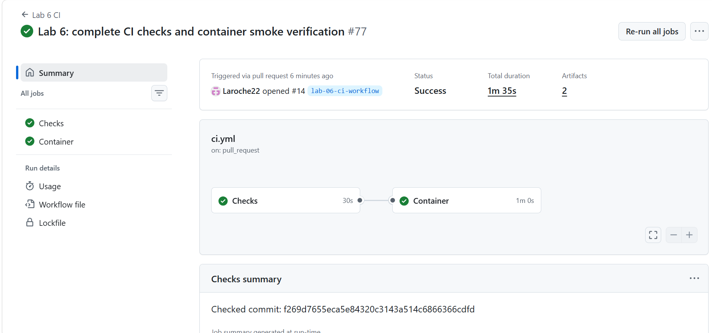
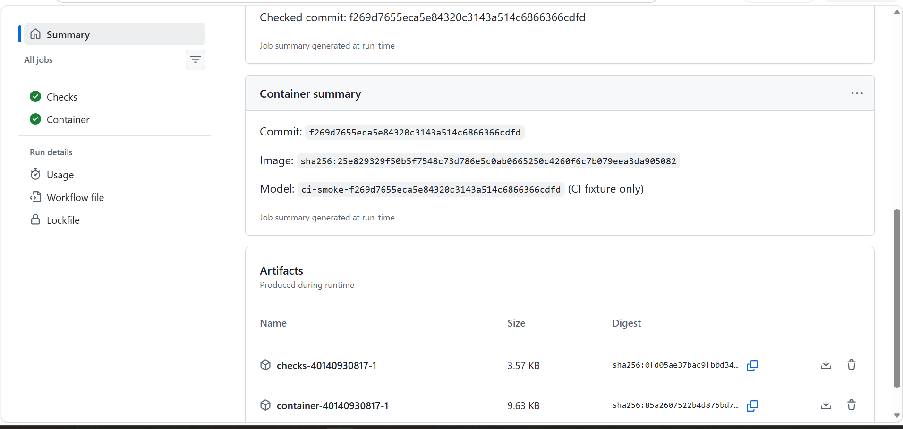

# Lab 6 — Phase 1 CI evidence

## Run identity

- Pull request: [#14](https://github.com/Wanying0421/mlops-fri2-alna-bike-demand/pull/14).
- Workflow: `Lab 6 CI`; displayed run number: 77.
- [Run 40140930817, attempt 1](https://github.com/Wanying0421/mlops-fri2-alna-bike-demand/actions/runs/40140930817/attempts/1).
- Event: `pull_request`; branch: `lab-06-ci-workflow`.
- Last author commit shown in the pre-run PowerShell push: `7eff425` (abbreviated).
- Checked revision in both jobs: `f269d7655eca5e84320c3143a514c6866366cdfd`.
- JUnit timestamp: `2026-10-24T23:00:50.059489+00:00` (UTC), equivalent to
  25 October 2026 at 01:00:50 in Paris.
- GitHub summary: Success, two successful jobs, total duration 1 minute 35 seconds.

This workflow uses the default checkout for a pull-request event. GitHub tests
its prepared PR merge revision, which explains why the checked SHA differs
from the author's branch-head SHA. This does not indicate a completed manual
merge into `main`. See the [official event documentation](https://docs.github.com/en/actions/reference/workflows-and-actions/events-that-trigger-workflows#pull_request).

## Observed results

| Check | Result | Raw evidence |
| --- | --- | --- |
| Locked runner install | Passed; runner Python 3.12.3 | [install](checks/install.txt) |
| Ruff lint | All checks passed | [lint](checks/lint.txt) |
| Ruff formatting | 15 files already formatted | [format](checks/format.txt) |
| Preflight | Imports, frozen dataset and writable outputs passed | [preflight](checks/preflight.txt) |
| Complete runner suite | 73 passed, 1 warning in 7.74 s; JUnit: 0 failures/errors/skips | [pytest](checks/pytest.txt), [JUnit](checks/pytest.xml) |
| Docker build | Finished; locked installs; image Python 3.12.14 | [build](container/build.txt) |
| Complete inside-image suite | 73 passed, 1 warning in 12.88 s | [pytest](container/pytest.txt) |
| API health and valid prediction | HTTP 200; model/code identity matched; prediction 42.0 | [checker](container/external-check.txt) |
| Invalid hour (`hr=24`) | HTTP 422 with hour validation error | [checker](container/external-check.txt) |
| External checker | PASS, 0 failed checks, exit code 0 | [checker](container/external-check.txt) |
| Request logging | Health/prediction 200 and invalid prediction 422 recorded | [runtime log](container/container.log) |

The existing SQLAlchemy `noload` deprecation warning from MLflow is retained
in both pytest logs.

## Image and fixture identity

- Built image ID: `sha256:25e829329f50b5f7548c73d786e5c0ab0665250c4260f6c7b079eea3da905082`.
- Image revision label: `f269d7655eca5e84320c3143a514c6866366cdfd`.
- Model version: `ci-smoke-f269d7655eca5e84320c3143a514c6866366cdfd`.
- Reported model SHA-256: `398c67f9cf0b508594ac251597c40370067b26aa872e50a497a0cd638dead411`.

The image ID in the build log agrees with `image-id.txt` and `identity.txt`.
The checked SHA and fixture version agree across both jobs, image labels,
metadata, health response and external checks. The model hash is reported
by generated metadata; model weights were not included in the evidence
artifacts, so their bytes were not independently verified during this review.

The model is a labelled synthetic CI fixture. These results cover installation,
tests, image construction, startup, HTTP validation and identity for this run.
They do not establish real-model accuracy, Cloud Run deployment, an independent
defect drill or a release tag.

## Provenance and retention

The `checks/` and `container/` files are byte-for-byte copies of the two artifacts
downloaded by the author and supplied for inspection:

| Supplied archive | SHA-256 of supplied ZIP |
| --- | --- |
| `checks-40140930817-1.zip` | `0fd05ae37bac9fbbd34f86e2856a3cafad0e9e2634f3b50e6a183d5debeaea3c` |
| `container-40140930817-1.zip` | `85a2607522b4d875bd757a8a91174725b1eaea08979c8646bc27c9066532f660` |

Screenshots supplement the raw logs. `SHA256SUMS.txt` records the bytes in this
directory. Its `.gitattributes` prevents line-ending conversion within this
directory, preserving the downloaded evidence on Windows and Linux.

This is historical evidence for the revision above. Adding it to the PR
creates another commit and another CI run. The reviewer must inspect the
latest run before merge; this earlier pass does not certify later commits.

## Screenshots

