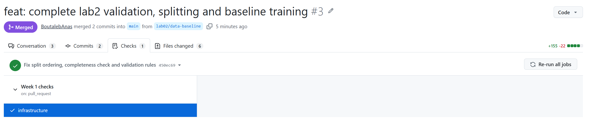
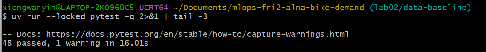
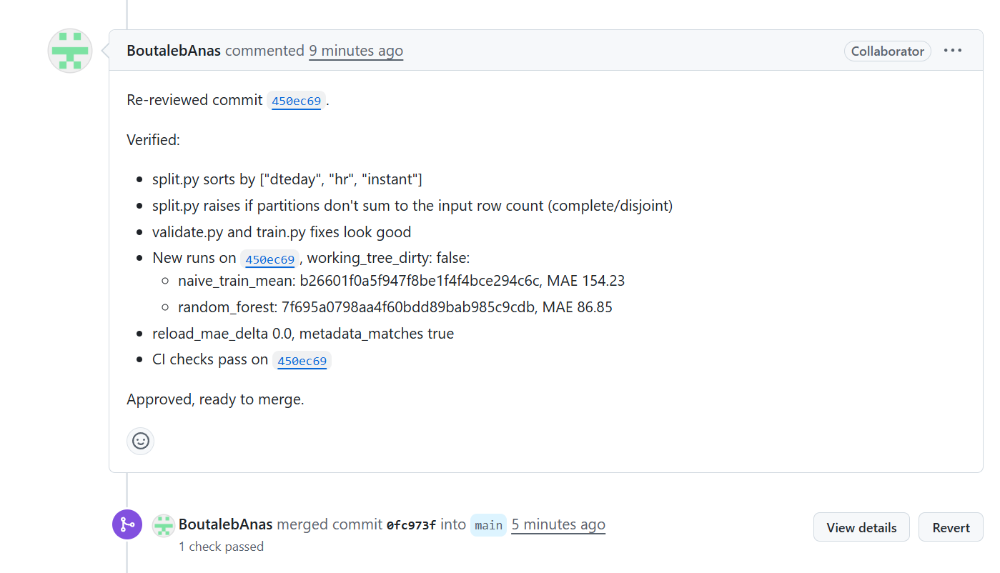
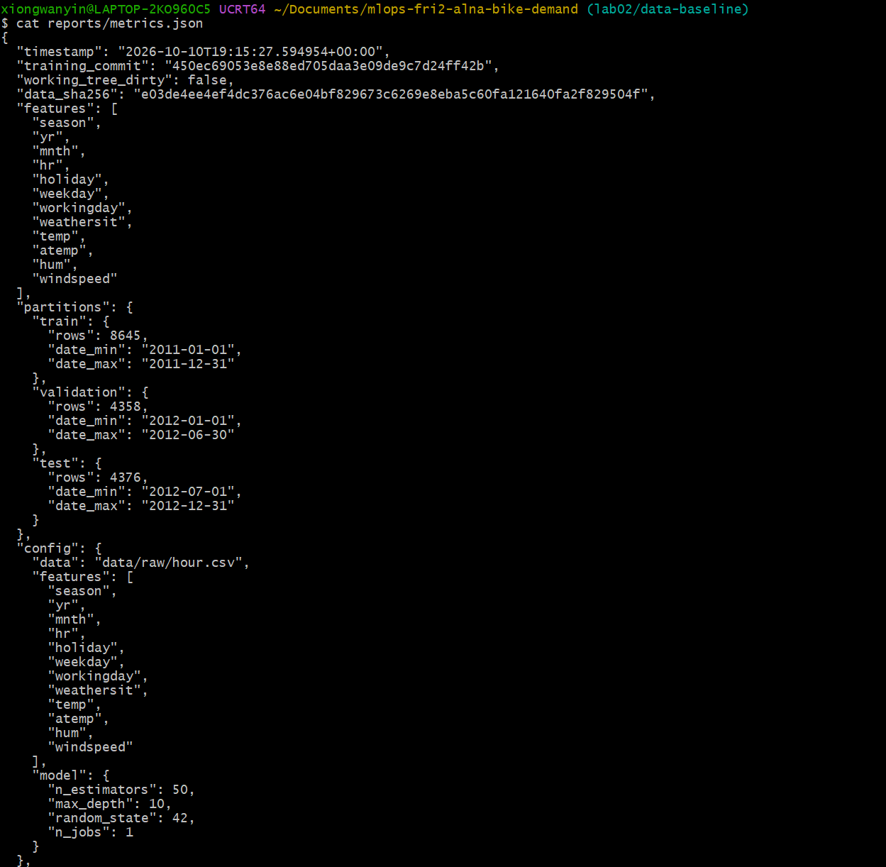
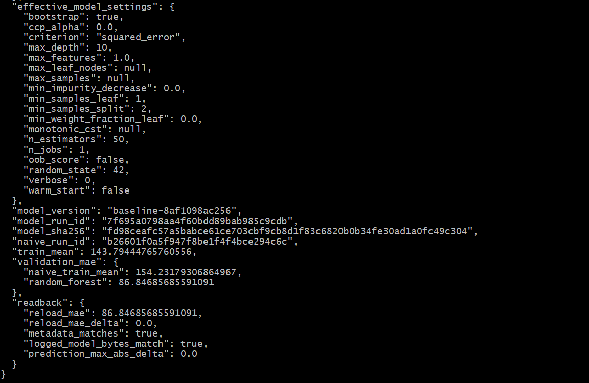
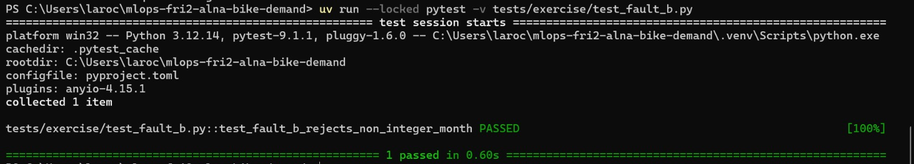
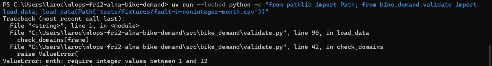
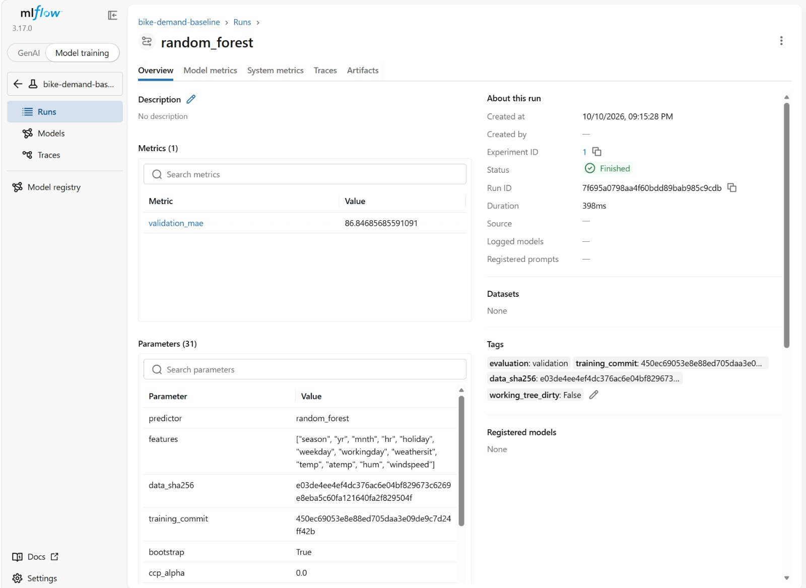
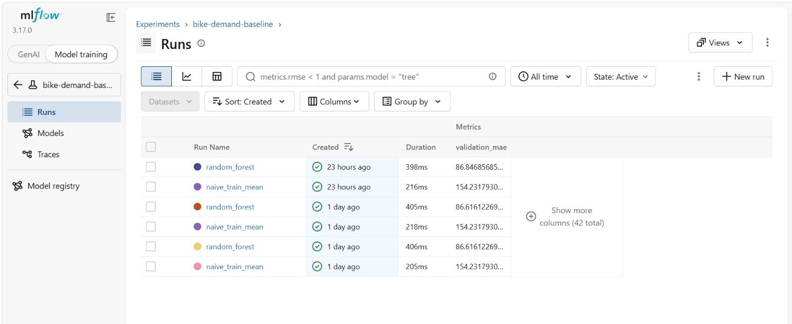

# Week 1, Labs 1–2: team evidence

## Team and roles

- Repository: mlops-fri2-alna-bike-demand
- Members: Laroche22, BoutalebAnas, nouhasantir, Wanying0421
- Lead Lab 01: BoutalebAnas
- Reviewer Lab 01: nouhasentir
- Lead Lab 02: Wanying0421
- Reviewer Lab 02: BoutalebAnas
- Data validation and split: Laroche22
- Fault injection and tests: nouhasantir
- Training and MLflow tracking: Wanying0421
- Review and merge: BoutalebAnas

## Repository and pull requests

- PR #1: lab-01-workflow to main, checked commit 41523de (Lab 01)
- PR #2: lab-01-docs tp main, checked commit 2cdf30b (Lab 01 docs)
- PR #3: lab02/data-baseline to main, checked commit 450ec69 (Lab 02)
- PR #4: lab-02-fault-b to main, checked commit 3bb5fe1 (Lab 02 Fault B)
- Merge commits on main: 41523de, 2cdf30b, 0fc973f, 3bb5fe1

## Setup, preflight and quality checks (commands and actual results)

- uv sync --locked : dependencies installed
- uv run --locked python -m bike_demand.preflight : Preflight passed: imports, frozen snapshot and writable outputs.
- uv run --locked ruff check . : All checks passed!
- uv run --locked ruff format --check . : all files already formatted
- uv run --locked pytest -q -m infra : 9 passed
- uv run --locked pytest -q -m lab1 : 4 passed
- uv run --locked pytest -q → 48 passed, 1 warning in 16.01s
- uv run --locked python -m bike_demand.validate --data data/raw/hour.csv : Validated 17379 rows; input bytes unchanged.
- uv run --locked pytest -q tests/exercise/test_fault_b.py : 1 passed in 0.63s

## Data identity, validator checks and added test

- Data: data/raw/hour.csv, sha256: "e03de4ee4ef4dc376ac6e04bf829673c6269e8eba5c60fa121640fa2f829504f"
- Validator: rejects invalid categorical domains, normalized ranges, nonnegative counts, date windows
- Added test (Lab 01): test_normalize_team_slug_rejects_none
- Added test (Lab 02): tests/exercise/test_fault_b.py. It asserts rejection for a non-integer month
- Fault B fixture: tests/fixtures/fault-b-noninteger-month.csv
- Valid control: tests/fixtures/fault-b-valid-control.csv

## Partition counts, boundaries and held test rows

- Train: 8645 rows, 2011-01-01 -> 2011-12-31
- Validation: 4358 rows, 2012-01-01 -> 2012-06-30
- Test: 4376 rows, 2012-07-01 -> 2012-12-31 (held, not evaluated)

## Comparator and RF: run IDs, validation MAEs, metadata/readback

- Naive train mean: run ID b26601f0a5f947f8be1f4f4bce294c6c, validation MAE 154.23
- Random Forest: run ID 7f695a0798aa4f60bdd89bab985c9cdb, validation MAE 86.85
- Train mean: 143.79
- metadata_matches: true
- reload_mae_delta: 0.0
- logged_model_bytes_match: true
- prediction_max_abs_delta: 0.0

## Optional stretch, after the core: unchanged-config repeat (new run IDs, history, differences)

not attempted

## Fault diagnosis and your own Fault B

- Choice: changed one mnth value from 1 to 1.5, breaking only the integer requirement while keeping all 17 columns intact.
- Reason: protects against type confusion in the categorical domain : the validator must reject non-integer categories instead of silently coercing.
- Result: valid control is accepted, the faulty input raises ValueError mentioning mnth, the input file remains unchanged. Limitation: full exercise suite was blocked locally on Windows due to SciPy _hausdorff DLL application control, so CI was used to confirm.

## Review observation and author's response

- Finding (reviewer BoutalebAnas, PR #3): split.py sorted only by dteday : it requires (dteday, hr, instant). Also missing complete/disjoint assertion.
- Author's response (Wanying0421): fixed in commit 450ec69, sort updated to ["dteday", "hr", "instant"] and a completeness check added.
- Re-verified: all 48 tests pass, runs on 450ec69 with working_tree_dirty: false; CI checks pass on 450ec69.
- Approved and merged.

## Contribution and assistance/recovery acknowledgement

- Laroche22: implemented validate.py and split.py, designed Fault B (fractional-month) with its test and fixtures.
- nouhasantir: peer review of PR #1 and PR #2, reviewed Fault B on PR #4.
- Wanying0421: implemented train.py, MLflow tracking, model save/reload, opened PR #3 and PR #4, merged PR #1, #2 and #4.
- BoutalebAnas: opened PR #1 and PR #2, peer review on PR #3, merged PR #3.
- Starter code and pipeline scaffolds provided by the instructor.

## Blockers and next action

- Blockers: Local exercise suite blocked on Windows for one member due to SciPy _hausdorff DLL application control, CI was used to confirm. No remaining blockers.
- Next action: implement one bounded TODO in Week 2 (Docker + clean rerun)
- The lead and the reviewer for Week 2 must be different individuals(rotation).

## Screenshots

Save images in `reports/images/`; embed each with a caption naming the commit or run
it shows (for example PR checks, MLflow runs, validator output). Hide tokens and
personal data.

PR #3 checks passed on commit 450ec69.

uv run --locked pytest -q -> 48 passed in 16.01s.

Re-review on commit 450ec69 : approved and merged (merge commit 0fc973f).

reports/metrics.json showing partitions, features, MAEs and readback on commit 450ec69.

reports/metrics.json readback section: reload_mae_delta 0.0, metadata_matches true.

pytest -v tests/exercise/test_fault_b.py → 1 passed in 0.60s.

load_data on fault-b-noninteger-month.csv raises ValueError: "mnth: require integer values between 1 and 12".

MLflow run random_forest : Run ID 7f695a0798aa4f60bdd89bab985c9cdb, validation_mae 86.84, training_commit 450ec69, working_tree_dirty False.

MLflow Runs table : naive_train_mean (MAE 154.23) and random_forest (MAE 86.84) on commit 450ec69.