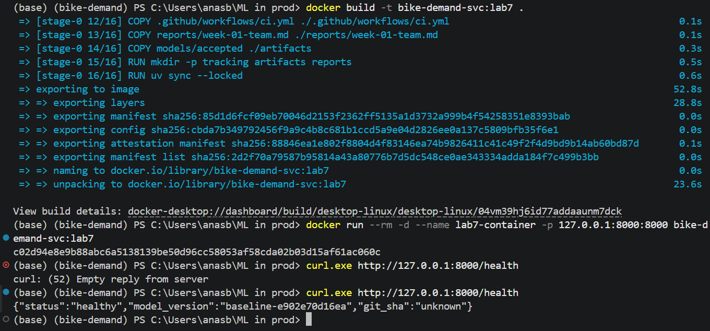
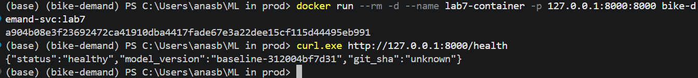

# Week 4 team report

## Lab 7 — Training pipeline, evaluation and quality gate

### Member 1 / Lead: implementation prepared for review

Source snapshot: `7d7e10fd3a3f36533c077732d21d07177fad32d6` (`m3`).
The source archive was inspected; no claim is made here that the current cloud
service has been independently verified.

Member 1 added a separate input-check/training entry point. It validates the
frozen data and splits, fits on 2011 only, and writes a uniquely identified
candidate with byte hashes, configuration, dependency lock, environment,
training revision and partition identities. It never writes the accepted model,
accepted pointer, existing tracking database or legacy metrics report.

Training exit 0 means `trained`, with `evaluation_status: not_evaluated`.
It does not mean eligible, accepted or deployed. Training requires committed
inputs. Failed/interrupted candidates have no completion marker, and rerunning
an existing ID is refused. Synthetic tests cover the preservation of accepted
files, train-only fitting, identity hashes, collisions, incomplete execution,
mid-run input changes and invalid model settings.

The legacy main-push deployment job generated the CI smoke fixture before cloud
deployment and only echoed a verification message. It was removed to prevent
automatic fixture promotion during Lab 7 integration. The two CI verification
jobs remain. This change does not alter the existing live service.

The team interface and ownership proposal is in
[`docs/lab7-contract.md`](../docs/lab7-contract.md). The initial design choices
are in the README's **Pipeline and gate** section. Local check scope and raw
results are in [`evidence/lab7/member1/`](../evidence/lab7/member1/).

### Integration and verification

The training pipeline was merged in [PR #18](https://github.com/Wanying0421/mlops-fri2-alna-bike-demand/pull/18). [PR #21](https://github.com/Wanying0421/mlops-fri2-alna-bike-demand/pull/21) updated the quality gate and decision record generation. [PR #20](https://github.com/Wanying0421/mlops-fri2-alna-bike-demand/pull/20) added manual promotion and rollback. Both PRs are now merged into `main`.

### Peer review: repeated promotion

During the review of PR #20, Laroche reproduced a rollback issue with the sequence A → B → B. After promoting B a second time, both `current` and `previous` pointed to B, so the rollback reference no longer pointed to A.

Anas updated the promotion command so that running it again for the active model leaves both references unchanged. He added a regression test for this scenario. The expected result is `current = B` and `previous = A`. Both GitHub checks passed before the merge.

### Local results on `main`

| Check | Observed result |
| --- | --- |
| Dataset and chronological split | `inputs_validated`: 8,645 training rows, 4,358 validation rows and 4,376 held-out test rows. |
| Candidate bundle | `bundle_verified` for the candidate linked in the [training evidence](../evidence/lab7/training/candidate-371763a94ef249af915ac55c3355351a/). |
| Candidate evaluation | `not_evaluated`: this run did not produce a validation score or a gate decision. |

The following captures show the local Docker demonstration shared in PR #20:

### Evidence still to document

- The command that runs training, evaluation and the gate together, with a link to the gate policy and a decision based on the validation results.
- A rejection example showing that the accepted model stayed unchanged.
- The model version and revision verified on Cloud Run, with the previous revision identified for rollback.
