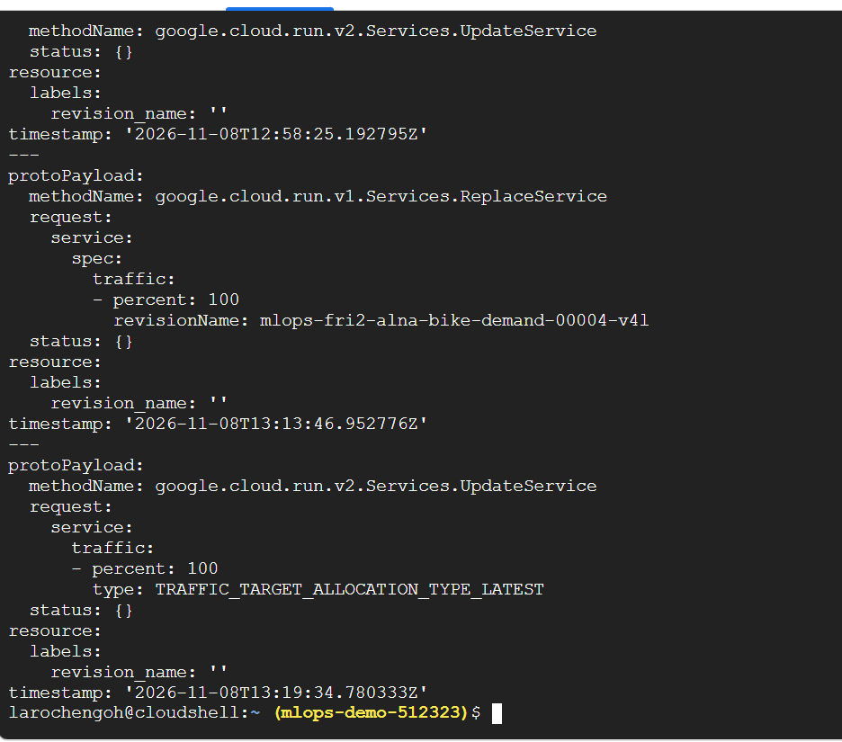
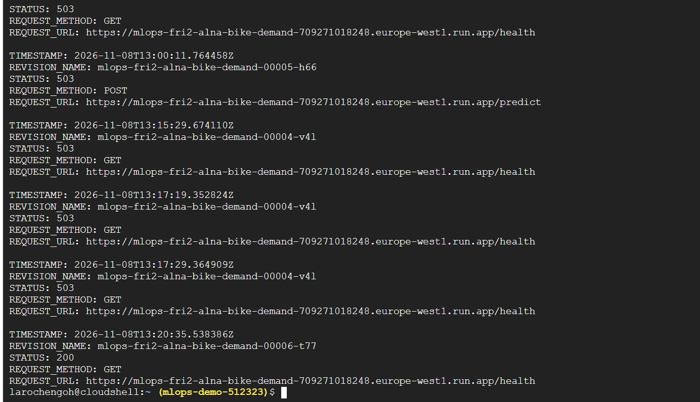
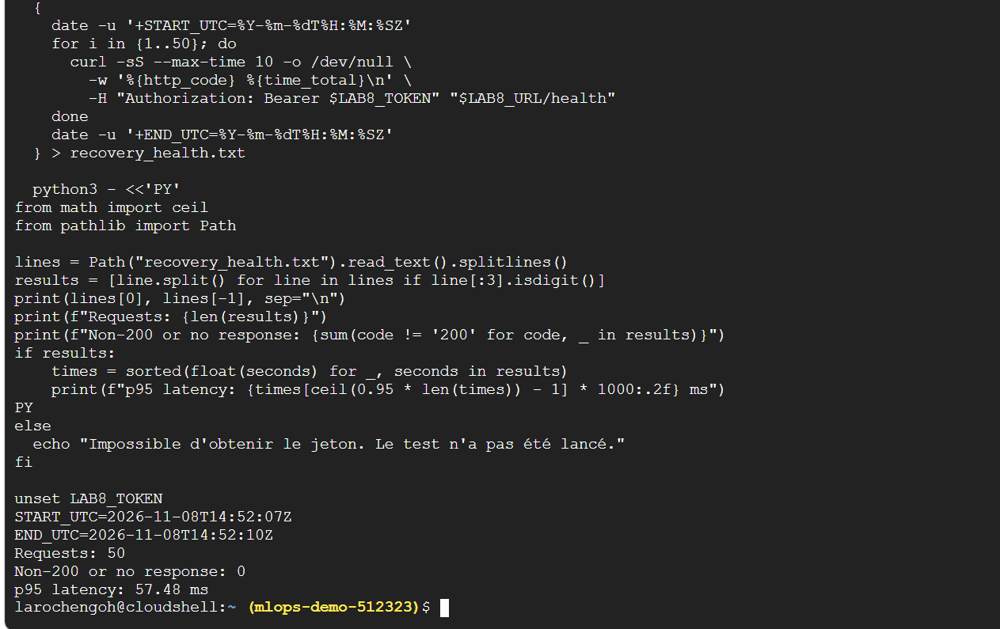

# Week 4 team report

## Lab 7 — Training pipeline, evaluation and quality gate

### Member 1 / Lead: implementation prepared for review

Source snapshot: `7d7e10fd3a3f36533c077732d21d07177fad32d6` (`m3`).
The source archive was inspected; no claim is made here that the current cloud
service has been independently verified.

Member 1 added a separate input-check/training entry point. It validates the
frozen data and splits, fits on 2011 only, and writes a uniquely identified
candidate with byte hashes, configuration, dependency lock, environment,
training revision and partition identities. It never writes the accepted model,
accepted pointer, existing tracking database or legacy metrics report.

Training exit 0 means `trained`, with `evaluation_status: not_evaluated`.
It does not mean eligible, accepted or deployed. Training requires committed
inputs. Failed/interrupted candidates have no completion marker, and rerunning
an existing ID is refused. Synthetic tests cover the preservation of accepted
files, train-only fitting, identity hashes, collisions, incomplete execution,
mid-run input changes and invalid model settings.

The legacy main-push deployment job generated the CI smoke fixture before cloud
deployment and only echoed a verification message. It was removed to prevent
automatic fixture promotion during Lab 7 integration. The two CI verification
jobs remain. This change does not alter the existing live service.

The team interface and ownership proposal is in
[`docs/lab7-contract.md`](../docs/lab7-contract.md). The initial design choices
are in the README's **Pipeline and gate** section. Local check scope and raw
results are in [`evidence/lab7/member1/`](../evidence/lab7/member1/).

### Integration and verification

The training pipeline was merged in [PR #18](https://github.com/Wanying0421/mlops-fri2-alna-bike-demand/pull/18). [PR #21](https://github.com/Wanying0421/mlops-fri2-alna-bike-demand/pull/21) updated the quality gate and decision record generation. [PR #20](https://github.com/Wanying0421/mlops-fri2-alna-bike-demand/pull/20) added manual promotion and rollback. Both PRs are now merged into `main`.

### Peer review: repeated promotion

During the review of PR #20, Laroche reproduced a rollback issue with the sequence A → B → B. After promoting B a second time, both `current` and `previous` pointed to B, so the rollback reference no longer pointed to A.

Anas updated the promotion command so that running it again for the active model leaves both references unchanged. He added a regression test for this scenario. The expected result is `current = B` and `previous = A`. Both GitHub checks passed before the merge.

### Local results on `main`

| Check | Observed result |
| --- | --- |
| Dataset and chronological split | `inputs_validated`: 8,645 training rows, 4,358 validation rows and 4,376 held-out test rows. |
| Candidate bundle | `bundle_verified` for the candidate linked in the [training evidence](../evidence/lab7/training/candidate-371763a94ef249af915ac55c3355351a/). |
| Candidate evaluation | `not_evaluated`: this run did not produce a validation score or a gate decision. |

The following captures show the local Docker demonstration shared in PR #20:


### Evaluation and quality-gate evidence

The evaluation results were provided by Wanying and merged into `main` in
[PR #25](https://github.com/Wanying0421/mlops-fri2-alna-bike-demand/pull/25).

These results complement Member 1's earlier local bundle check, which reported
`not_evaluated`.

The frozen accepted reference is `baseline-dd901b9c0fa5`, a Random Forest
with 50 trees and maximum depth 10.

Model artifact SHA-256:

```text
fd98ceafc57a5babce61ce703cbf9cb8d1f83c6820b0b34fe30ad1a0fc49c304
```

All validation results use the same 4358 rows from January–June 2012.

| Model | Validation MAE | Reported outcome |
| --- | ---: | --- |
| Train-mean baseline | 154.23 | Comparison reference |
| Accepted Random Forest: 50 trees, depth 10 | 86.85 | Frozen incumbent |
| Normal candidate: 50 trees, depth 10 | 86.85 | Eligible |
| Weak candidate: 1 tree, depth 1 | 116.52 | Rejected |

The normal candidate matches the incumbent; no accuracy improvement is claimed.

The weak candidate performs better than the train-mean baseline but worse
than the accepted model, and was rejected. The evidence records
`accepted_unchanged: true`, confirming that the accepted model hashes
remained unchanged after rejection.

Evidence:

- [Normal-candidate evaluation](../evidence/lab7/evaluation/evaluation-normal.json)
- [Weak-candidate evaluation and rejection](../evidence/lab7/evaluation/evaluation-weak.json)

### Final held-test evaluation — Week 5

Wanying reports that the selected model and the train-mean baseline were
evaluated once on the 4376 held-test rows from July–December 2012.

| Model | Held-test MAE |
| --- | ---: |
| Train-mean baseline | 182.21 |
| Selected Random Forest | 93.74 |

These held-test results are separate from the validation measurements
used for the Lab 7 gate.

Evidence: [Final held-test results](../evidence/final/held-test.json).

### Remaining integration and deployment evidence

- Document the exact command or sequence connecting training, evaluation
  and the gate, with a link to the versioned gate policy.
- Complete the remaining gate-policy documentation, including its
  operational threshold and threshold justifications. Reporting a baseline
  score does not by itself establish that the gate implements a baseline rule.
- As reported by Wanying on 11 November 2026, Cloud Run still serves
  `ci-smoke-7d7e10fd3a3f36533c077732d21d07177fad32d6`, rather than
  `baseline-dd901b9c0fa5`. Deployment of the accepted model remains pending.
- After deployment, record the new revision and container identity,
  verify authenticated `/health` and `/predict` responses against the
  expected model version, and retain the previous revision for rollback.
  The previously observed operational revision, `00006-t77`, serves the
  smoke model and must not be described as the accepted Lab 7 model.


## Lab 8 — Incident diagnosis and recovery

The team investigated HTTP 503 errors on the Bike Demand Cloud Run service. The rollback to `00004-v4l` did not restore the service. A subsequent traffic update routed requests to `00006-t77`, where `/health` returned HTTP 200.

### Timeline

| Date and time (UTC) | Event |
|---|---|
| Nov 7, 21:29:29–21:29:47 | Member 1 recorded the baseline: 50 `/health` requests, 0 errors, p95 latency of 60.84 ms. |
| Nov 7, 22:19:07 | The first documented drill signal was HTTP 503 on `/health`. |
| Nov 8, 13:00:11 | `/health` and `/predict` returned HTTP 503 with `Model not loaded`. The request log identified `00005-h66` for the failed `/predict` call. |
| Nov 8, 13:13:46 | The audit log recorded a rollback request to send 100% of traffic to `00004-v4l`. |
| Nov 8, 13:15:29–13:17:29 | Three `/health` requests on `00004-v4l` still returned HTTP 503. |
| Nov 8, 13:19:34 | A second traffic update requested 100% of traffic to `LATEST`. |
| Nov 8, 13:20:35 | `/health` returned HTTP 200 on `00006-t77`. |

The errors observed on November 7 and November 8 do not establish continuous downtime between those dates.

### Diagnosis

| Revision | Configured `MODEL_PATH` | Result |
|---|---|---|
| `00005-h66` | `/app/artifacts/not-there.joblib` | Model did not load; `/predict` returned 503. |
| `00004-v4l` | `/app/models/does_not_exist.joblib` | Model did not load; `/health` still returned 503 after the rollback. |
| `00006-t77` | `/app/artifacts/model.joblib` | Model loaded; `/health` and `/predict` returned 200. |

Member 3’s configuration checks support an incorrect `MODEL_PATH` as the cause. Invalid prediction input did not explain the incident because `/health` also failed without a prediction payload. The team did not verify whether the model file existed elsewhere in the failing container images.

### Recovery verification

Member 4 independently verified that `00006-t77` received 100% of traffic. A valid `/predict` request returned HTTP 200 with a prediction of `42.0`, and an empty request returned the expected HTTP 422.

| Period | Documented `/health` requests | Non-200 responses | p95 latency |
|---|---:|---:|---:|
| Baseline, Nov 7 | 50 | 0 | 60.84 ms |
| Incident sample, Nov 8 | At least 4 | At least 4, all HTTP 503 | Not measured |
| Recovery, Nov 8, 14:52:07–14:52:10 UTC | 50 | 0 | 57.48 ms |

The incident logs cover only a sample of requests, so they do not establish an overall incident error rate. The recovery checks confirm that the service worked during the observed window. The team did not verify that `00006-t77` used the accepted Lab 7 model bundle. For future drills, verify that the target revision can load its model before sending traffic to it.

### Evidence

[Raw results from the 50 recovery probes](images/recovery_health.txt)

**Figure 1 — Rollback request and subsequent traffic update**




**Figure 2 — Failed requests and HTTP 200 on the recovered revision**



**Figure 3 — Recovery probes: 50 requests, 0 errors, p95 of 57.48 ms**


